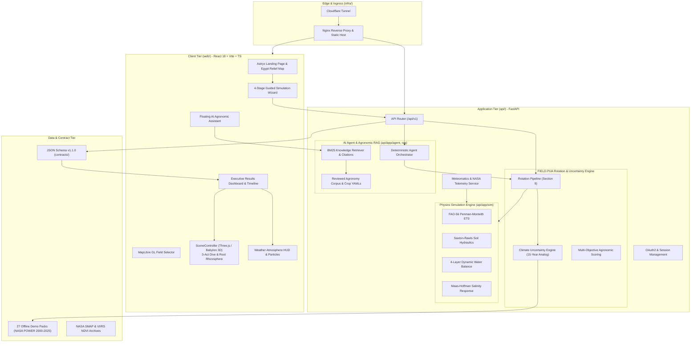

# System Architecture: Journey Into the Soil

Decision-support platform for **NASA Space Apps Challenge 2026: "Field Shift: Adapting Farms with NASA Data"**  
Team: **The Shifters**

---

## 1. High-Level Architecture

The system is designed with a contract-first, decoupled architecture connecting client-side interactive 3D visualization and mapping with a deterministic agro-hydrological simulation backend, source-grounded agronomic RAG, and live satellite telemetry services.

---

## 2. Backend Modules & Physical Simulation

### A. Physics Engine (`api/app/sim`)
The physical simulation executes daily soil-water-crop dynamics without machine-learning hallucinations:
1. **Reference Evapotranspiration ($ET_0$)**: FAO-56 Penman-Monteith formulation calculated from solar radiation ($R_s$), maximum/minimum temperature ($T_{max}, T_{min}$), 2m wind speed ($u_2$), and relative humidity ($RH$).
2. **Pedotransfer Hydraulics**: Saxton-Rawls (2006) equations deriving wilting point ($\theta_{wp}$), field capacity ($\theta_{fc}$), saturation ($\theta_{sat}$), and saturated hydraulic conductivity ($K_{sat}$) from soil texture (% sand, % clay) and organic matter (% OM).
3. **4-Layer Water Balance**: Multi-layer soil reservoir (Layer 0: 0–15 cm, Layer 1: 15–30 cm, Layer 2: 30–60 cm, Layer 3: 60–100 cm). Simulates daily precipitation infiltration, surface runoff, matric flux percolation, direct soil evaporation, and root extraction proportional to dynamic rooting depth.
4. **Salinity Yield Penalty**: Maas-Hoffman piecewise linear salinity response modeling osmotic threshold ($EC_e$) and yield reduction slope under varying irrigation water salinity ($EC_w$).
5. **Headless Execution**: Fast headless execution mode (`record_daily=False`) enabling high-speed evaluation of multi-crop candidate rotations across multi-year analog weather series.

### B. Rotation & Climate Uncertainty Engine (`api/app/engine`)
Implements the FIELD.PUA Section 9 rotation pipeline:
1. **Agronomic Feasibility**: Filters candidate crops by thermal growing season windows (Winter, Summer, Nili), soil texture suitability, and salinity tolerance.
2. **Rotation Rules**: Enforces botanical family alternation, nitrogen-fixing legume inclusion (e.g., berseem clover), and root morphology alternation (deep taproot vs shallow fibrous).
3. **Historical Climate Uncertainty Sweep (Schema 1.1.0)**:
   - Evaluates candidate rotations across 15 historical analog weather years (2011–2025) derived from NASA POWER datasets.
   - Calculates empirical percentiles ($p10, p50, p90$) for seasonal irrigation requirements, water stress index, salinity penalty, extreme heat days ($>35^\circ\text{C}$), and total composite score.
   - Computes `rank_stability` (fraction of historical analog years where the recommended strategy retains top rank) and penalizes confidence when score variance is high.
4. **Strategy Triad**: Generates three clear, comparative options:
   - `existing`: The user's baseline crop sequence.
   - `primary`: The top-ranked risk-adjusted strategy maximizing farmer objectives.
   - `contrast`: An alternative high-performing strategy trading water savings against net margin.

### C. Source-Grounded RAG & Deterministic Agent (`api/app/agent`, `api/app/rag`)
- **Deterministic Orchestration (`/agent/recommend`)**: Executes the physics engine, validates inputs, and formats actionable insights. An optional LLM phrasing layer explains recommendations in plain language, but the LLM never generates numbers or rankings.
- **Source-Grounded Assistant (`/agent/ask`, `/knowledge/search`)**: Ingests reviewed agronomic documentation (`knowledge/agronomy/*.md`) and crop parameter files (`knowledge/*.yaml`). Employs BM25 extractive retrieval with strict citation attribution. Out-of-domain inquiries are explicitly refused rather than hallucinated.

### D. Telemetry & NASA Observational Services (`api/app/services`)
- **Meteomatics Weather & Multi-Depth Soil API**: Fetches downscaled weather and multi-depth Soil Moisture Index ($SMI_{5cm}$, $SMI_{50cm}$) telemetry. Automatically grounds initial topsoil and subsoil conditions, raising a `flag.pre_sowing_deficit` when initial soil moisture deficit ($SMD$) exceeds 50 mm.
- **NASA SMAP & VIIRS NDVI Evidence**: Reads real satellite observations (`SPL3SMP_E` surface moisture and `VNP13A1` v002 vegetation greenness) for demo sites. Provides statistical satellite-vs-model comparisons ($RMSE$, $MAE$, Pearson $r$) with explicit labels clarifying satellite penetration depth limitations.

---

## 3. Frontend Architecture (`web/`)

### A. Core Stack
- **Framework**: React 18 with TypeScript and Vite.
- **Styling**: Tailwind CSS with Astryx design tokens, biophilic glassmorphic components, and full dark/light theme support.
- **State Management**: Zustand store managing active parcel coordinates, soil inputs, simulation results, selected strategy, and inspector focus.
- **Decoupled 3D Architecture**: React never manipulates 3D scene objects directly. All WebGL/3D operations pass strictly through `web/src/scene/SceneController.ts`.

### B. User Experience & Feature Modules
1. **Astryx Native Landing Page**:
   - Modern hero section with theme toggle, auth modal, and quick simulation launcher.
   - Interactive Egypt Relief Map with 27 calibrated governorate pins showing real-time agro-ecological zones.
   - Workflow feature cards, crop-talk preview, and PDF report export modal.
2. **4-Stage Guided Simulation Wizard (`SimulationWizard.tsx`)**:
   - Stage 1: Location & Land Parcel Selection (MapLibre GL satellite map with demo site shortcuts).
   - Stage 2: Soil Characteristics & Irrigation Infrastructure (texture, salinity, organic matter, irrigation method).
   - Stage 3: Crop History & Current Rotation (season-by-season crop sequence).
   - Stage 4: Climate Scenarios & Farmer Goals (temperature shift $\Delta T$, precipitation $\Delta P$, objective sliders).
3. **Cinematic 3D Rhizosphere Experience (`SoilScene.tsx`, `SceneController.ts`)**:
   - **3-Act Sky-to-Soil Dive**: Eye-level canopy view (date palms, cattle herd, field vegetation), ground-parting excavation dive, and subterranean stratified inspection.
   - **Multi-Plant Realistic Root Network**: Dense procedural root network across the Layer 1 cutaway face with organic branching splines, root hairs, and botanical shading.
   - **3D Weather Atmosphere System**: Dynamic particle systems for rainfall and dust motes, solar angle modulation, and wet/dry soil reflectance.
   - **Atmosphere HUD**: Floating glassmorphic widget displaying live temperature, humidity, reference evapotranspiration, and soil deficit indicators.
4. **Executive Results Dashboard (`ResultsDashboard.tsx`)**:
   - Executive summary cards for water savings, soil carbon trajectory, net income, and climate risk.
   - Multi-strategy comparison cards with why/evidence/risks breakdowns.
   - Interactive timeline scrubber playing daily soil moisture depletion and root elongation over the entire rotation cycle.
   - Observational NASA satellite evidence panel.
5. **Persistent Floating AI Assistant (`FloatingAssistantWidget.tsx`)**:
   - Floating biophilic assistant available across simulation and result views.
   - Context-aware prompt suggestions based on active simulation results.
   - Strict citation display for all agronomic advice.

---

## 4. Contract-First Interface & Internationalization

- **Single Interface Contract**: `contracts/result.schema.json` (Schema v1.1.0) defines the rigid API contract. All backend endpoints validate against this schema before responding.
- **Bilingual Internationalization (i18n)**:
  - English (LTR) and Modern Standard Arabic (RTL) supported across all UI views and engine messages.
  - Backend returns structured translation keys (`{key, params}`); frontend resolves them via `web/src/i18n/`.
  - Key parity is enforced automatically in CI via `scripts/check_i18n.py`.
- **Zero-Network Demo Capability**: 27 pre-compiled offline demo packs in `data/packs/demo_sites/` guarantee that presentations and demos operate with zero external network connectivity.

---

## 5. Deployment & Infrastructure

- **Containerization**: Multi-stage Docker build producing an optimized FastAPI backend image and an Nginx static web container.
- **Hardware Architecture**: Native support for Linux ARM64 (e.g. Oracle Cloud Infrastructure Ampere A1) and x86_64 AMD64.
- **Reverse Proxy & TLS**: Cloudflare Tunnel service in Docker Compose terminating HTTPS and routing traffic cleanly to internal ports (FastAPI on `:8000`, Web on `:8080`).
